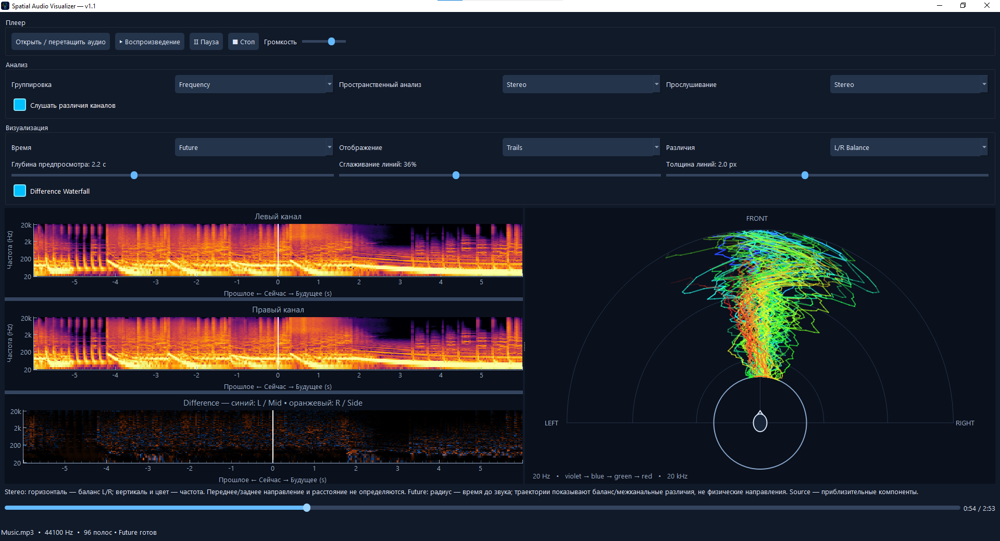
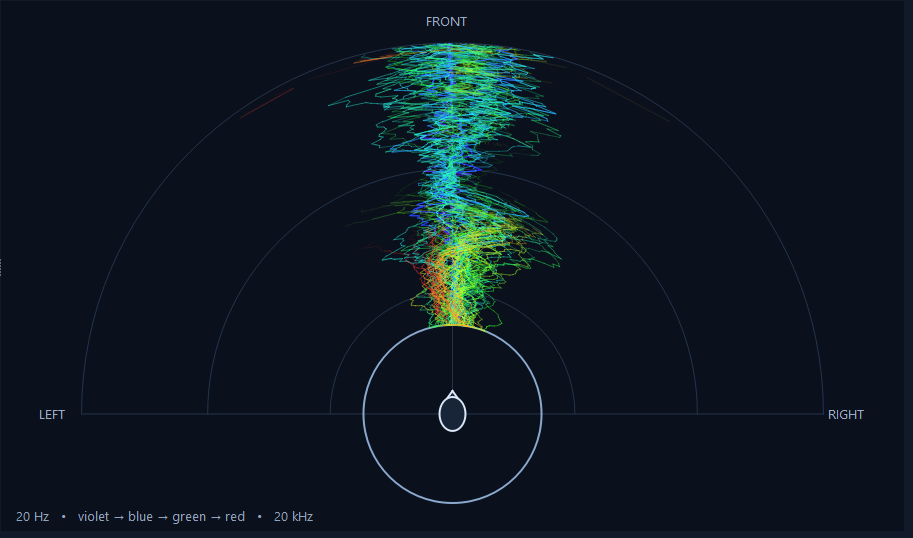
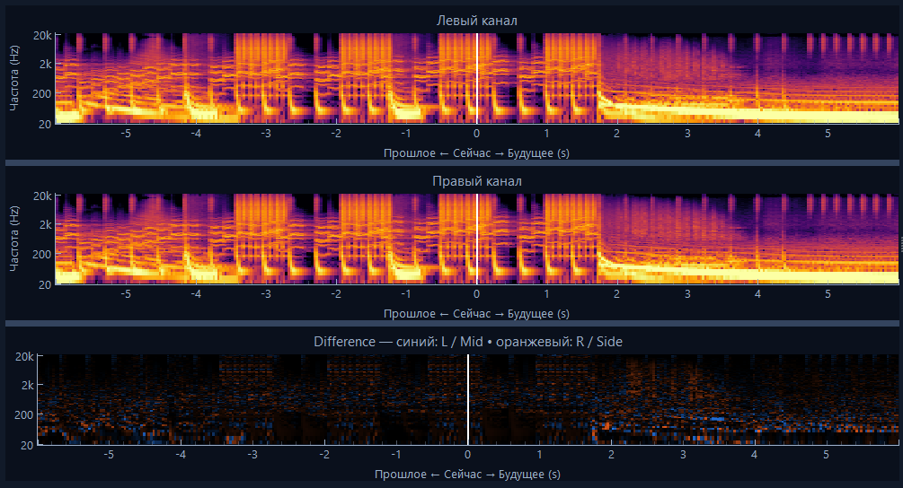

# SpectrumRadar

**Stereo Audio Analysis & Visualization for Windows**

SpectrumRadar is a free, open-source Windows application for exploring stereo recordings through spectral analysis, spatial visualization, and interactive playback.

**SpectrumRadar** — бесплатная программа с открытым исходным кодом для анализа, визуализации и воспроизведения стереозаписей.

**[Download SpectrumRadar for Windows / Скачать SpectrumRadar.exe](https://github.com/anoouen/SpectrumRadar/releases/download/v1.0.0/SpectrumRadar.exe)**

No installation or Python required. / Установка Python не требуется.



---

## English

### Features

**Channel Difference Listening**

One of the main features of SpectrumRadar is the ability to listen to the differences between the left and right audio channels.

The application uses spectral processing to suppress shared components, revealing stereo details, spatial effects, and sounds that may be less noticeable during normal playback.

Unlike simple left/right channel switching, this mode considers spectral magnitude and phase relationships.

**Stereo Spectrograms**

- Separate 96-band spectrograms for left and right channels.
- Frequency visualization covering approximately 20 Hz to 20 kHz, depending on the sample rate.
- Display of past and upcoming audio around the playback position.
- Interactive seeking directly through the spectrograms.

**Difference Waterfall**

A color-coded visualization of stereo differences with two available modes:

- L/R Balance — compares the left and right channels.
- Mid/Side — visualizes common and differential stereo components.

**Spatial Audio Visualization**

Audio frequencies are displayed on a circular spatial map, using stereo balance to represent their apparent distribution.

An experimental 360° analysis mode is also available.

**Future Trails**

Displays pre-analyzed upcoming audio events as moving colored particles or continuous trajectories.

Available controls include preview duration, trajectory smoothing, line thickness, and frequency/source grouping.

**Playback and Interface**

- Supports WAV, FLAC, and MP3 files.
- Stereo and mono playback.
- Volume control, pause, stop, and seeking.
- Drag-and-drop audio loading.
- Adjustable interface panels and visualization settings.
- Remembers interface preferences between sessions.

### Important Notes

Spatial visualization estimates characteristics of a stereo signal. It does not determine actual sound-source coordinates or physical distances.

Channel Difference Listening suppresses common signal components but does not guarantee perfect separation of instruments or individual sound sources.

The program analyzes audio files rather than capturing system audio in real time.

---

## Русский

### Возможности

**Прослушивание различий между каналами**

Одна из главных функций SpectrumRadar — возможность отдельно прослушивать составляющие звука, различающиеся между левым и правым каналами.

Программа использует спектральную обработку для подавления общей части стереосигнала, что позволяет услышать малозаметные детали записи, пространственные эффекты и звуки, которые при обычном прослушивании могут быть менее различимы.

Это не просто переключение между левым и правым каналами: при обработке учитываются амплитудные и фазовые характеристики сигнала.

**Спектрограммы стереозвука**

- Две отдельные 96-полосные спектрограммы для левого и правого каналов.
- Отображение частот примерно от 20 Гц до 20 кГц с учётом частоты дискретизации.
- Просмотр уже прозвучавших и предстоящих участков аудиозаписи.
- Интерактивная перемотка непосредственно через спектрограммы.

**Difference Waterfall**

Цветовая визуализация различий между каналами с двумя режимами:

- L/R Balance — сравнение левого и правого каналов.
- Mid/Side — отображение общих и разностных компонентов стереосигнала.

**Пространственная визуализация**

Частотные компоненты отображаются на круговой карте. Их положение зависит от характеристик стереосигнала, прежде всего баланса между каналами.

Также предусмотрен экспериментальный режим анализа 360°.

**Future Trails**

Режим отображает предстоящие звуковые события в виде движущихся разноцветных частиц или непрерывных траекторий.

Можно изменять глубину предпросмотра, сглаживание и толщину линий, а также переключаться между частотной группировкой и приблизительными звуковыми компонентами.

**Воспроизведение и интерфейс**

- Поддержка WAV, FLAC и MP3.
- Воспроизведение в Stereo и Mono.
- Регулировка громкости, пауза, остановка и перемотка.
- Открытие аудиофайлов перетаскиванием.
- Настройка размеров панелей и параметров визуализации.
- Сохранение настроек интерфейса между запусками.

### Ограничения

Пространственная визуализация показывает характеристики стереосигнала, а не реальные координаты источников звука или расстояния до них.

Подавление общих составляющих не гарантирует полного разделения отдельных инструментов и звуковых источников.

Программа анализирует загруженные аудиофайлы, а не весь системный звук Windows в реальном времени.

---

## Screenshots / Скриншоты

### Future Trails — Audio Trajectories / Звуковые траектории



### Stereo Spectrograms & Difference Waterfall / Анализ стереозвука



---

## Installation / Установка

### Windows executable / Готовая программа

Download the latest available release from:

[**GitHub Releases — SpectrumRadar**](https://github.com/anoouen/SpectrumRadar/releases)

To run the Windows version, download `SpectrumRadar.exe` and open it.

Для запуска скачайте `SpectrumRadar.exe` из раздела Releases и откройте файл. Python устанавливать не нужно.

### Run from source / Запуск из исходников

Requires Python 3.12 on Windows.

Для запуска из исходного кода установите Python 3.12, скачайте репозиторий и запустите `start.bat`.

При первом запуске BAT-файл создаст виртуальное окружение `.venv` и установит необходимые библиотеки через интернет.

Alternatively / Либо выполните вручную:

```bat
py -3.12 -m venv .venv
.venv\Scripts\python.exe -m pip install -r requirements.txt
.venv\Scripts\python.exe spatial_audio.py
```

**Technical note / Техническое примечание:** аудиофайл загружается в память и предварительно анализируется целиком. Для длинных записей может потребоваться значительный объём оперативной памяти и время на обработку. Поддержка конкретных аудиофайлов зависит от возможностей используемой libsndfile.

---

## Technology / Технологии

- Python
- PySide6 / Qt
- NumPy
- SciPy
- PyQtGraph
- SoundFile / libsndfile
- SoundDevice

## License / Лицензия

SpectrumRadar's original source code is available under the **MIT License**. See [LICENSE](LICENSE).

Исходный код SpectrumRadar распространяется на условиях **MIT License**. Лицензии сторонних библиотек применяются отдельно. При распространении готовых сборок необходимо соблюдать условия лицензирования включённых компонентов, в частности Qt/PySide6 и libsndfile.

## Author / Автор

**anoouen**

[GitHub profile](https://github.com/anoouen)

Copyright © 2026 anoouen.
